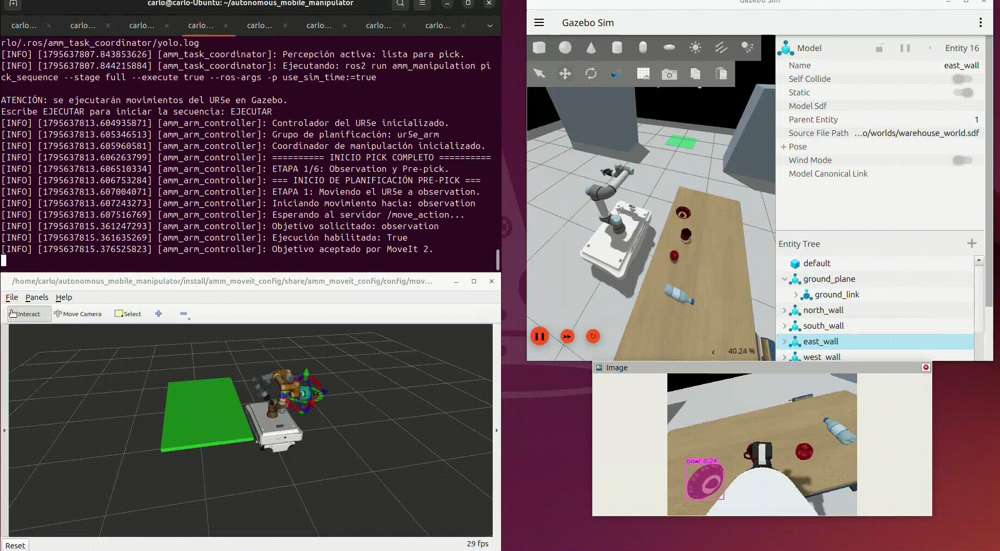
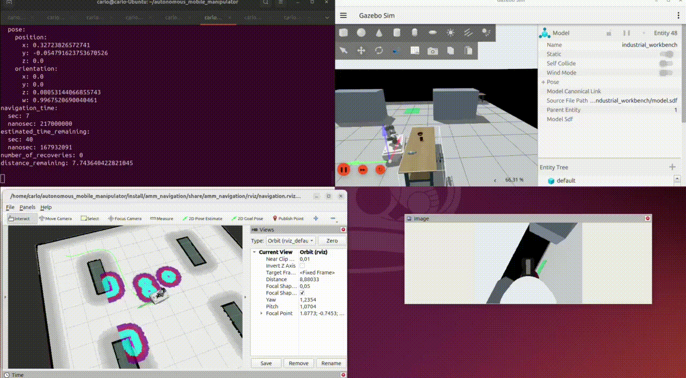

# Autonomous Mobile Manipulator

**Autonomous Mobile Manipulation with ROS 2, Nav2, MoveIt 2 and YOLO-Based RGB-D Perception**

An autonomous mobile manipulation system developed in **ROS 2 Jazzy** and simulated using **Gazebo Harmonic**. The project integrates a MiR100 mobile robot, a UR5e robotic arm, a Robotiq 2F-85 gripper and a wrist-mounted Intel RealSense D435 RGB-D camera.

The system combines autonomous navigation, object detection and segmentation, 3D perception, motion planning and robotic manipulation to execute industrial pick-and-place missions.

## Demonstration

The system receives a high-level instruction specifying **which object to pick and which destination station to deliver it to**.

For example, the following command initiates an autonomous mission to pick an apple, transport it to Station 1, place it on the destination table and return to the starting position:

```bash
ros2 run amm_manipulation task_coordinator \
  --object apple \
  --destination mesa1 \
  --execute true \
  --ros-args -p use_sim_time:=true
```

The following demonstrations show two stages of this mission, executed through the same command.

### 1. Autonomous Object Detection and Pick



The robot detects the target object using YOLO segmentation, estimates its three-dimensional position from RGB-D data, plans a collision-aware grasp using MoveIt 2 and executes the pick operation with the UR5e and Robotiq gripper.

### 2. Autonomous Navigation and Place



After securing the object, the mobile platform navigates autonomously to the selected destination using Nav2. The manipulator then executes the placement sequence and releases the object onto the destination table.

## System Architecture

The project integrates four main subsystems:

| Subsystem | Technologies | Responsibility |
|---|---|---|
| Mobile Navigation | Nav2, AMCL, SLAM Toolbox | Mapping, localization, path planning and autonomous motion |
| Object Perception | YOLO11 Segmentation, OpenCV, RGB-D | Object recognition, segmentation and 3D position estimation |
| Robotic Manipulation | MoveIt 2, UR5e, Robotiq 2F-85 | Motion planning, collision avoidance, grasping and placement |
| Mission Coordination | ROS 2, Python, TF2 | High-level mission execution and subsystem synchronization |

The complete workflow is organized as follows:

```text
             HIGH-LEVEL TASK
            "apple, mesa1"
                   |
                   v
             TASK COORDINATOR
                   |
                   v
          RGB-D OBJECT PERCEPTION
                   |
            YOLO SEGMENTATION
                   |
          3D POSITION ESTIMATION
                   |
                   v
            MOVEIT 2 - PICK
                   |
          OBJECT ATTACHMENT
                   |
                   v
          NAV2 - NAVIGATION
                   |
          DESTINATION STATION
                   |
                   v
            MOVEIT 2 - PLACE
                   |
           OBJECT DETACHMENT
                   |
                   v
          RETURN TO HOME POSE
```

## Robotic Platform

| Component | Model |
|---|---|
| Mobile base | MiR100 |
| Robotic manipulator | Universal Robots UR5e |
| End effector | Robotiq 2F-85 |
| RGB-D camera | Intel RealSense D435 |
| Simulation environment | Gazebo Harmonic |
| Middleware | ROS 2 Jazzy |
| Operating system | Ubuntu 24.04 |

The complete robotic platform is simulated with integrated joint controllers, sensor interfaces, coordinate transformations and collision-aware motion planning.

## Autonomous Navigation

The navigation subsystem uses **Nav2** to autonomously move the mobile manipulator between workstations.

Main components include:

- **SLAM Toolbox:** environment mapping.
- **AMCL:** localization against a previously generated map.
- **NavFn:** global path planning.
- **Regulated Pure Pursuit:** local trajectory control.
- **Behavior Tree Navigator:** navigation task execution.
- **Global and local costmaps:** obstacle representation and collision-aware navigation.

The robot uses LiDAR measurements and odometry to navigate within the simulated industrial environment.

## Object Detection and 3D Perception

The perception pipeline combines deep learning with RGB-D geometry to estimate object positions relative to the robot.

The simulated environment includes several YCB objects:

- Apple
- Mug
- Bowl
- Mustard bottle

The perception pipeline performs instance segmentation, depth processing, 3D point estimation and TF2 transformations into the robot reference frame.

The software architecture separates object recognition from grasp planning, allowing object-specific manipulation strategies to be developed independently.

## Motion Planning and Manipulation

Manipulation is performed using **MoveIt 2**, integrated with the UR5e manipulator and the Robotiq 2F-85 gripper.

The manipulation pipeline includes:

1. Target pose estimation using RGB-D perception.
2. Pre-grasp pose generation.
3. Collision-aware motion planning.
4. Cartesian approach toward the object.
5. Gripper closure and object attachment.
6. Retraction to a safe transport configuration.
7. Navigation to the destination station.
8. Placement, object detachment and arm retraction.

The planning environment incorporates collision objects representing workbenches and detected objects.

Safety checks prevent the manipulator from descending when required collision geometry is missing from the MoveIt Planning Scene.

## Multi-Object and Multi-Station Architecture

The high-level mission interface separates the selected object from the destination station:

```text
<object>, <destination>
```

This design enables the integration of multiple object manipulation strategies and destination stations without changing the overall mission architecture.

The simulated environment includes four destination stations, while the demonstrated end-to-end mission validates the apple-to-Station-1 workflow. Additional object–station combinations can be integrated and tested using the same coordination framework.

## Implementation Highlights

- Modular ROS 2 architecture with dedicated packages.
- Integrated Gazebo Harmonic simulation.
- RGB-D perception and TF2 coordinate transformations.
- YOLO-based instance segmentation.
- Autonomous localization and navigation.
- MoveIt 2 motion planning and collision management.
- Robotiq gripper control.
- Object attachment and detachment.
- High-level mission coordination.
- Automated subsystem startup and shutdown.

## Repository Structure

```text
src/
├── amm_description/
├── amm_gazebo/
├── amm_control/
├── amm_slam/
├── amm_navigation/
├── amm_perception/
├── amm_manipulation/
└── amm_moveit_config/

media/
├── pick_demo.gif
└── navigation_place_demo.gif

docs/
└── technical_report.pdf
```

## Requirements

- Ubuntu 24.04 LTS
- ROS 2 Jazzy
- Gazebo Harmonic
- Nav2
- MoveIt 2
- Python 3
- OpenCV
- Ultralytics YOLO
- Required ROS 2 control and simulation dependencies

Installation and build instructions depend on the packages and model assets included in the repository.

## Technical Documentation

A detailed engineering report describing the system architecture, simulation environment, perception pipeline, autonomous navigation, manipulation, integration testing and technical challenges is available here:

**[Technical Engineering Report (PDF)](docs/technical_report.pdf)**

## Future Development

Further development will focus on generalizing grasp strategies across YCB object geometries, validating additional destination stations, improving placement with visual feedback and benchmarking mission reliability across repeated trials.

---

**Project focus:** Autonomous Robotics · ROS 2 · Computer Vision · Motion Planning · Mobile Manipulation
